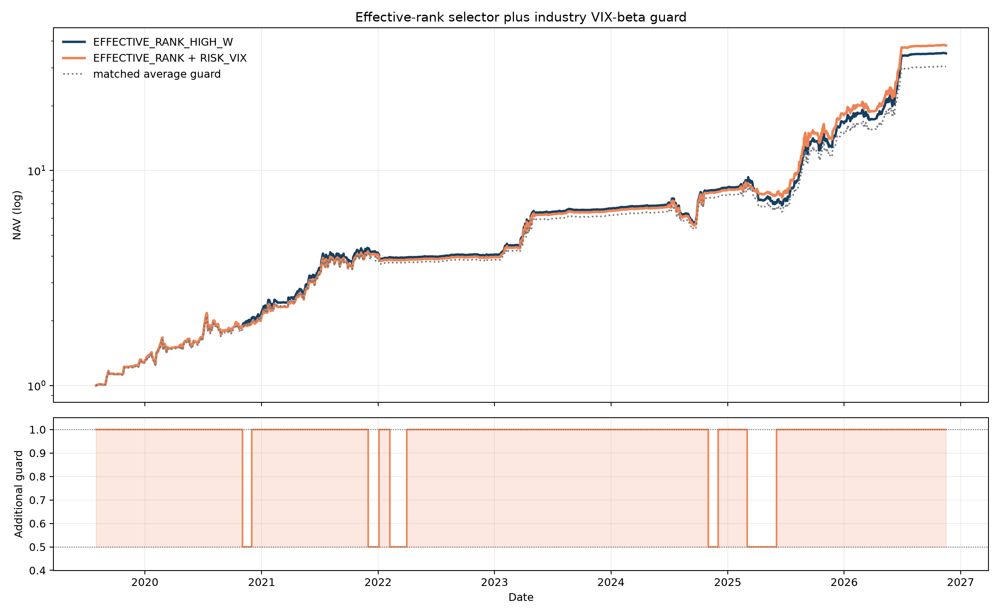

# 有效秩选择器 + 行业 RISK_VIX

标签：`ER_RISK_VIX@20261122`
父策略：`EFFECTIVE_RANK_HIGH_W@R20261116`
状态：`EXPLORATORY / SHADOW_ONLY / NO_PRODUCTION_CHANGE`

该候选把18个科技行业的36个月VIX敏感度用作防守条件，分别叠加在W和V2
两个候选分支内部，再由原有效秩选择器选择W或V2。它不是把两个最终净值按资金
比例直接混合，也没有改变有效秩的W/V2选择状态。

## 策略逻辑 text 流程图

```text
18行业月度收益 + VIX最近可得收盘
  -> 36个月滚动 OLS: R_i,m = a_i + b_i * ΔVIX_m + ε_i,m
  -> VIX 252日分位 state_rank

V2原行业选择（ΔC Top5 ∩ RV Top3）
  -> 当年入选行业的 beta 横截面分位均值 selected_beta_rank
  -> guard=0.5 iff state_rank>=0.80 and selected_beta_rank<=0.50
  -> 分别作用于 V2原敞口

W原策略
  -> 同一个行业级 guard
  -> 分别作用于 W原敞口

(W guarded, V2 guarded)
  -> 原63日协方差有效秩
  -> 分位>50%选W，否则选V2
  -> W/V2切换首日额外扣10bp
  -> 最终组合收益
```

完整时点、公式、状态迁移和代码映射见 [`ALGORITHM.md`](ALGORITHM.md)。

## 核心定义

行业VIX Beta：

```text
R_i,m = a_i + b_i ΔVIX_m + ε_i,m
```

使用36个月月度窗口；`ΔVIX`是VIX点位一阶差分。VIX映射到当时可获得的A股
最近收盘，不使用随后公布的海外收盘。Beta只定义在行业层，同一个行业映射出的
不同ETF不会被赋予不同的行业Beta。

防守条件：

```text
β̄_t = mean(rank_pct(b_i,t), i ∈ selected_industries)
guard_t = 0.5  if VIX_pct_t >= 0.80 and β̄_t <= 0.50
        = 1.0  otherwise
exposure_t = original_exposure_t × guard_t
```

## 全期绩效

样本：2019-08-01至2026-11-16。`EFFECTIVE_RANK_HIGH_W`和
`ER_BASE_COST`在同一条1767日轴上计算。

| 分支换手成本 | 策略 | CAGR | Sharpe | MDD | Calmar |
|---|---:|---:|---:|---:|---:|
| 5bp | `EFFECTIVE_RANK_HIGH_W` | 65.40% | 2.281 | -26.15% | 2.501 |
| 5bp | `ER_BASE_COST`重放 | 65.40% | 2.281 | -26.15% | 2.501 |
| 5bp | **`ER_RISK_VIX`** | **67.41%** | **2.405** | **-23.26%** | **2.898** |
| 5bp | 同平均防守系数 | 62.12% | 2.276 | -24.97% | 2.488 |
| 10bp | 10bp重建基准 | 63.26% | 2.207 | -26.45% | 2.392 |
| 10bp | **10bp + RISK_VIX** | **65.31%** | **2.330** | **-23.41%** | **2.790** |
| 10bp | 10bp同平均防守系数 | 60.12% | 2.202 | -25.26% | 2.380 |

这里的10bp不是只对新增防守动作计费：`branch_returns_10bp.csv`对整个W/V2
分支换手使用10bp，此外仍保留有效秩W/V2切换的独立10bp。机器可读表见
[`outputs/performance_comparison.csv`](outputs/performance_comparison.csv)。

### 起止日口径提示

父策略单独发布的1766日统计为65.44% / 2.282；本实验使用源账本的1767日轴，
首日收益为0，因此同一条父策略在本包中为65.40% / 2.281。累计收益相同，
普通日收益最大差仅约`4.3e-16`，差异来自年化天数分母和一个零收益日。
包内所有候选使用相同日期轴，不能把65.44%与67.41%混作严格同轴差。

## 统计检验

21日循环块bootstrap，4000次，随机种子`20261122`：

| 成本 | 对照 | Sharpe差bootstrap 95%区间 | 双侧p |
|---|---|---:|---:|
| 5bp | `ER_BASE_COST` | `[-0.029, +0.245]` | 0.207 |
| 5bp | 同平均防守系数 | `[-0.036, +0.237]` | 0.264 |
| 10bp | 10bp重建基准 | `[-0.029, +0.246]` | 0.204 |
| 10bp | 10bp同平均防守系数 | `[-0.036, +0.238]` | 0.262 |

四个区间均跨零。点估计改善和成本后方向一致，但统计确认不足，故不能升级
生产配置。

风险预算测试覆盖2024-2026全段；2026样本内没有触发，因此2026列中
`ER_RISK_VIX`与父策略完全相同。触发共8个月：

```text
2020-10 W
2021-11 W
2022-01 V2
2022-02 V2
2024-10 V2
2025-02 W
2025-03 W
2025-04 V2
```

## 如何复现

```bash
cd tech-rotation/effective-rank-riskvix-20261122
uv run --python 3.12 --with pandas --with numpy python code/test_replay.py
uv run --python 3.12 --with pandas --with numpy python code/replay_frozen.py
uv run --python 3.12 --with pandas --with numpy python code/generate_guard_panel.py
```

`replay_frozen.py`只使用本目录的冻结分支收益和月度选择表。行业VIX Beta原始
生成需要项目内部行业面板和VIX快照，边界及命令见
[`data/README.md`](data/README.md)与[`reports/VALIDATION.md`](reports/VALIDATION.md)。

## 边界

- 历史已查看，不是独立OOS；
- ETF成员历史及供应商修订链仍为`PARTIAL`；
- Copeland式行业VIX敏感性仅在本地18个科技行业上做代理扩展，不声称逐项复现原文样本；
- 2024-2026的改善不能外推为未来收益；
- 当前决策是保留为影子候选，生产配置不变。


