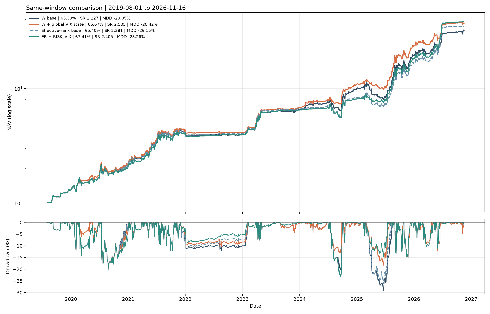
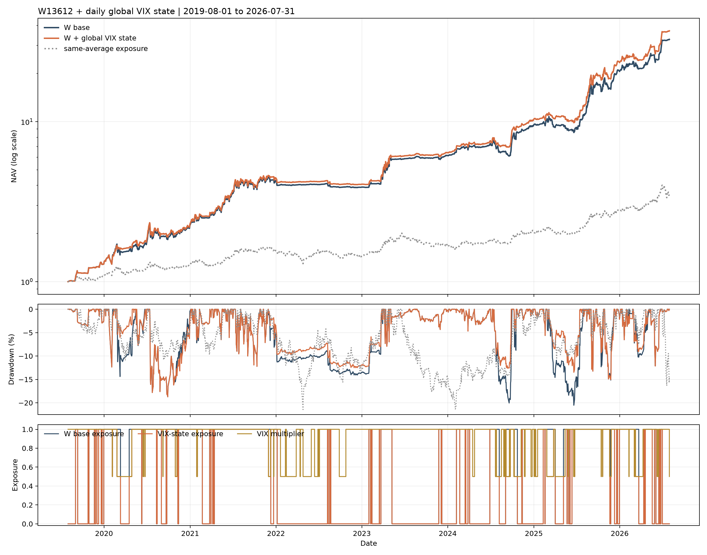

# W13612 + 全球VIX日频状态

标签：`W13612-GLOBAL-VIX@20261116`

架构父策略与精确数据父策略分为两层：

```text
base architecture:
  W13612-A015-MOMBIN-3OF5-VOTEONLY-ETF-BC50-BOND30-v1

exact replay/data parent:
  W13612-A015-MOMBIN-3OF5-VOTEONLY-ETF-BC50-BOND30-R20261116
```

状态：`ROBUST_SHADOW_ONLY / NO_PRODUCTION_CHANGE`

该候选只在W原策略最终风险敞口上增加一层全球VIX防守，不改变行业选择、ETF映射、
A015、MOMBIN、BC50或债券切换。

`v1` 定义了策略架构，但本文所有刷新账本指标使用 `R20261116` 数据快照重建。
因此不能把下表结果直接套到冻结 `v1` tag 的 `70.53% / 2.459 / -20.05%` 账本上；
刷新W在 `2019-08-01..2026-07-31` 的可直接复算结果为
`67.17% / 2.346 / -20.52%`。

与`W base`、`Effective-rank base`和`ER + RISK_VIX`的逐层架构差异见
[`reports/STRATEGY_ARCHITECTURES.md`](reports/STRATEGY_ARCHITECTURES.md)。

## 策略逻辑 text 流程图

```text
CBOE VIX
  -> 映射到最近可得的A股日期
  -> 整体滞后一个A股交易日
  -> 252个交易日历史分位
  -> 分位>=80%时multiplier=0.5，否则=1
  -> 再滞后一个A股交易日执行

W13612原策略
  -> 18行业选择
  -> ETF候选映射/BC50
  -> A015 + MOMBIN + DAR/TIP/MA120/DD
  -> W原final_exposure
  -> final_exposure × VIX multiplier
  -> 原ETF目标、债券余额、完整换手成本
```

## 核心公式

```text
g_t = 0.5  if percentile_252(VIX_{t-lag}) >= 0.80
    = 1.0  otherwise

exposure_t = W_original_exposure_t × g_t
```

VIX采用保守双重滞后：先映射到A股日期并滞后，状态生成后再滞后一次生效。该口径沿用
R3B，宁可延迟，不使用尚未形成的海外收盘。

## 同一截止日比较

所有策略均从2019-08-01到2026-11-16，共1767个交易日，5bp分支成本：

| 指标 | W base | W + global VIX state | Effective-rank base | ER + RISK_VIX |
|---|---:|---:|---:|---:|
| CAGR | 63.39% | 66.67% | 65.40% | **67.41%** |
| Sharpe | 2.227 | **2.505** | 2.281 | 2.405 |
| MDD | -29.05% | **-20.42%** | -26.15% | -23.26% |
| Calmar | 2.182 | **3.265** | 2.501 | 2.898 |

收益优先仍是`ER + RISK_VIX`；Sharpe和回撤优先是`W + global VIX state`。



## 稳健性

在W可直接复算的2019-08-01至2026-07-31样本上：

| 策略 | CAGR | Sharpe | MDD |
|---|---:|---:|---:|
| W base | 67.17% | 2.346 | -20.52% |
| W + global VIX | **70.21%** | **2.600** | **-18.73%** |
| same-average exposure | 19.90% | 1.182 | -21.44% |

检验结果：

- 5bp对W base Sharpe差：`[+0.036,+0.333]`；
- 10bp与20bp成本下增量仍为正；
- 27组参数邻域全部为正增量；
- 500次循环移位安慰剂，单侧`p≈0.008`；
- 2019、2021、2022、2024四个起点方向一致。



## 前瞻影子

协议冻结日：2026-11-22。

当前首个影子状态：

```text
signal_date:      2026-11-20
effective_date:   2026-11-23
VIX last obs:     2026-11-18
VIX:              24.56
252日分位:         0.91865
multiplier:       0.5
```

当前W生产刷新仍为`BLOCKED_W_SOURCE_NOT_WIRED`，因此只登记VIX乘数，不伪造基础
敞口或前瞻收益。更新文件见[`data/forward_shadow.csv`](data/forward_shadow.csv)。

## 复现

```bash
uv run --python 3.12 --with pandas --with numpy python code/test_replay.py
uv run --python 3.12 --with pandas --with numpy python code/replay_frozen.py
uv run --python 3.12 --with pandas --with numpy --with matplotlib python code/make_chart.py
```

## 边界

- 所有历史已查看，不是独立OOS；
- W在2026-07-31后的生产刷新尚未接回，本包2026-11-16 W序列来自
  `...-R20261116` 刷新研究账本；
- ETF历史成员与供应商vintage仍为`PARTIAL`；
- VIX供应商实时发布时间和修订链未认证；
- 未来盈利`NOT_ASSESSED`；
- 不修改生产策略。

详细算法见[`ALGORITHM.md`](ALGORITHM.md)，稳健性报告见
[`reports/ROBUSTNESS.md`](reports/ROBUSTNESS.md)，四策略架构图见
[`reports/STRATEGY_ARCHITECTURES.md`](reports/STRATEGY_ARCHITECTURES.md)。
